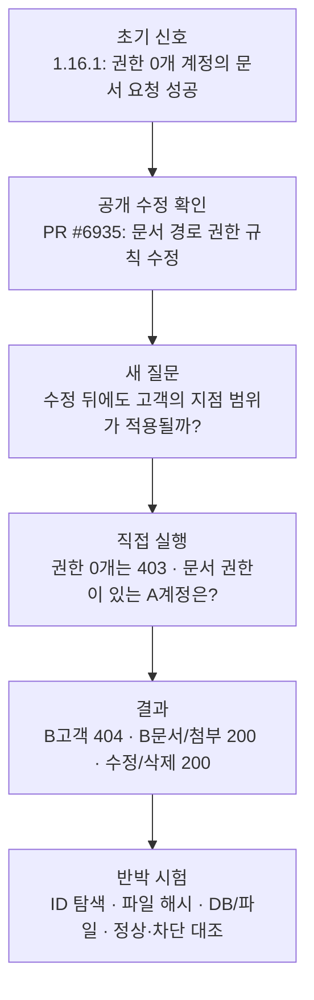

# 고객은 404, 문서는 200

### Apache Fineract 문서 API의 지점 권한 경계를 추적한 기록

> A지점의 제한된 계정은 B지점 고객 상세를 볼 수 없었다. 그런데 그 고객의 문서를 **찾고 → 읽고 → 수정하고 → 삭제**할 수 있었다. 삭제 후 DB 행과 실제 파일도 사라졌다.

**읽는 순서:** 이 페이지 → [한국어 한 장 요약](SUMMARY_KO.md) → [상세 재현 기록](DOCUMENT_OFFICE_VERIFICATION_STATUS_20261127.md) · [English technical overview](TECHNICAL_OVERVIEW_EN.md)

## ① 왜 이걸 의심했나

Fineract의 [지점 계층 문서](https://github.com/apache/fineract/blob/b033c13637123574a2242e39ce5e6aef29f58fdb/fineract-doc/src/docs/en/chapters/architecture/office-hierarchy-access.adoc)는 자기 지점과 하위 지점의 자원 접근을 설명한다. 실제로 A지점 계정의 **B고객 상세 조회는 `404`**였다.

그렇다면 같은 고객 ID를 경로에 쓰는 **문서 API도 B고객의 지점 경계를 확인할까?** 이 질문에서 시작했다.

## ② 어떻게 조사 방향을 좁혔나

처음 발견한 넓은 문서 경로 권한 누락은 이미 [PR #6935](https://github.com/apache/fineract/pull/6935)가 다뤘다. 그래서 **그 수정이 들어간 `develop` 커밋**을 새 DB에서 직접 실행하고, 수정 뒤에도 남는 *객체별 지점 범위*를 확인했다.

## ③ 실제로 무슨 일이 일어났나

실험에는 형제 지점 A·B, 가짜 고객과 PNG 문서를 만들었다. 공격 단계에는 **A지점 비관리자 계정 두 개**만 썼다. 둘 다 고객·문서 읽기 권한을 갖고, 각각 문서 수정 또는 삭제 권한 하나만 추가로 가졌다.

| A지점 계정이 B지점에 보낸 요청 | 결과 |
| --- | --- |
| B고객 상세 조회 | **`404`** — 고객은 보이지 않음 |
| 합성 고객 ID 1~16의 문서 목록 조회 | **`200`** — B문서 ID 7·8을 API에서 발견 |
| B문서 첨부 다운로드 | **`200`** — 준비한 PNG와 SHA-256 일치 |
| 올바른 B고객 경로로 문서 7 이름 수정 | **`200`** — 재조회한 이름이 바뀜 |
| 올바른 B고객 경로로 문서 8 삭제 | **`200`** — 재조회 `404`, DB 행·파일 없음 |

**대조:** 자기 지점 문서 작업은 성공했다. 문서 권한이 **0개**인 계정의 세부·첨부·수정·삭제는 수정 후 코드에서 `403`이었다. 즉, 메서드 권한 검사는 작동했고 **문서가 어느 지점 고객에게 속하는지**가 다음 검증 지점이었다.

> HTTP 코드: `200` 성공 · `403` 권한 거부 · `404` 요청한 고객을 보여주지 않음

## ④ 이 과정에서 배운 것

- **권한은 여러 층이다.** 로그인 여부, GET/PUT/DELETE 권한, *그 문서의 소속 고객에 접근할 권한*은 서로 다른 질문이다.
- **응답 코드만으로 끝내지 않았다.** 첨부 해시, 수정 후 이름, 삭제 후 DB 행과 물리 파일까지 확인해야 실제 영향을 설명할 수 있다.
- **이미 고쳐진 부분부터 분리했다.** 1.16.1의 경로 권한 누락과 수정 후 남은 교차 지점 동작을 같은 신규 결함으로 묶지 않았다.

**확인한 사실:** [`develop` 커밋 `b033c1363…`](https://github.com/apache/fineract/commit/b033c13637123574a2242e39ce5e6aef29f58fdb)을 직접 빌드·실행한 로컬 한 테넌트에서 위 동작이 재현됐다. **남은 판단:** `*_DOCUMENT` 권한이 원래 지점별인지 테넌트 전체인지에 대한 제품 정책 확인이 필요하다. 실제 금융기관이나 실제 고객 데이터는 시험하지 않았다.

## 증거를 따라가려면

| 보고 싶은 것 | 자료 |
| --- | --- |
| 조사 흐름을 더 자세히 | [한국어 한 장 요약](SUMMARY_KO.md) · [전체 검증 현황](DOCUMENT_OFFICE_VERIFICATION_STATUS_20261127.md) |
| API 탐색 → 읽기 → 수정·삭제 | [요청별 JSON](lab/evidence/document_office_single_account_chain_fresh_b033_regen_20261127.json) · [역할·문서 소속](lab/evidence/document_office_single_account_chain_fresh_b033_regen_db_20261127.txt) |
| 어떤 코드를 실제 실행했나 | [빌드·서버 출처](lab/evidence/document_office_single_account_chain_fresh_b033_regen_provenance_20261127.json) |
| 반대 사례도 확인했나 | [자기 지점 성공](lab/evidence/document_office_same_office_control_fresh_b033_regen_20261127.json) · [권한 0개 차단](lab/evidence/document_office_scope_b033_basic_zero_role_control_20261127.json) |
| 구현·버전·한계까지 검토 | [읽기 보고서](DOCUMENT_OFFICE_SCOPE_REPORT_KO.md) · [쓰기 보고서](DOCUMENT_OFFICE_WRITE_SCOPE_REPORT_KO.md) · [English technical overview](TECHNICAL_OVERVIEW_EN.md) |

**검증 시점:** 2026-11-27 (KST). 모든 요청은 직접 소유한 로컬 Fineract 서버의 합성 데이터에만 보냈다.
