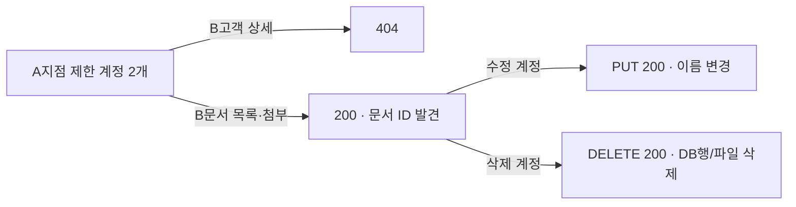

# 한 장 요약: 고객은 404, 문서는 200

**질문:** A지점 계정이 B지점 고객을 볼 수 없다면, 그 고객의 문서도 막힐까?

**답:** 로컬에서 실행한 Fineract `develop` [커밋 `b033c1363…`](https://github.com/apache/fineract/commit/b033c13637123574a2242e39ce5e6aef29f58fdb)에서는 **고객 상세 `404`**, **문서 목록·첨부 `200`**이었다. A지점 비관리자 계정 두 개가 B문서 ID를 API에서 직접 찾고, 올바른 B고객 경로로 각각 **이름 수정 `200`**과 **삭제 `200`**를 수행했다.

## 판단을 바꾼 네 가지 확인

| 생각한 문제 | 해 본 일 | 얻은 답 |
| --- | --- | --- |
| 처음 본 문서 경로 권한 누락이 새 문제인가? | 공식 1.16.1과 공개 [PR #6935](https://github.com/apache/fineract/pull/6935) 비교 | 해당 경로 권한 누락은 공개 수정과 겹침. 수정 **이후**의 객체 범위를 보기로 함 |
| 메서드 권한 수정만으로 지점 경계도 지켜질까? | 수정 후 `develop`을 빈 DB에서 직접 기동; A계정으로 B고객·문서 비교 | 문서 권한 0개는 `403`, 문서 권한을 가진 A계정은 B고객 `404`·B문서 `200` |
| 대상 ID를 미리 알아야만 하나? | 합성 고객 ID 1~16을 제한 계정으로 조회 | B문서 ID 7·8을 API에서 발견 |
| `200`이 실제 변경·삭제를 뜻하나? | 첨부 해시·수정 후 이름·삭제 후 DB와 파일 확인 | 원본 파일 수신, 이름 변경, DB 행·파일 삭제 확인 |

**공격 단계의 권한:** 두 계정 모두 `READ_CLIENT`·`READ_DOCUMENT`. 수정 계정에는 `UPDATE_DOCUMENT`, 삭제 계정에는 `DELETE_DOCUMENT`만 추가했다. 관리자는 합성 자료와 계정을 만드는 준비 단계에만 사용했다.

## 조사에서 얻은 원칙

1. **경로에 권한 검사가 있어도 객체 범위 검사는 별개다.** 수정 후 코드에서 권한 0개 요청은 차단됐지만, 문서 권한 계정의 교차 지점 동작은 남았다.
2. **API 응답과 서버 상태를 함께 봐야 한다.** 문서 첨부 해시, 수정된 이름, 삭제된 DB 행·물리 파일을 대조했다.
3. **공개 수정을 먼저 확인하면 다음 가설이 선명해진다.** 이미 다뤄진 경로 규칙과 남은 고객·문서 지점 범위를 분리했다.

**검증 범위:** 2026-11-27, 직접 소유한 로컬 서버의 합성 고객·PNG. `*_DOCUMENT` 권한이 원래 지점별인지 테넌트 전체인지는 제품 정책 확인이 필요하다.

**근거:** [요청별 기록](lab/evidence/document_office_single_account_chain_fresh_b033_regen_20261127.json) · [역할·소속 DB 대조](lab/evidence/document_office_single_account_chain_fresh_b033_regen_db_20261127.txt) · [빌드·실행 출처](lab/evidence/document_office_single_account_chain_fresh_b033_regen_provenance_20261127.json) · [자기 지점 대조](lab/evidence/document_office_same_office_control_fresh_b033_regen_20261127.json) · [권한 0개 대조](lab/evidence/document_office_scope_b033_basic_zero_role_control_20261127.json) · [전체 검증 현황](DOCUMENT_OFFICE_VERIFICATION_STATUS_20261127.md)
